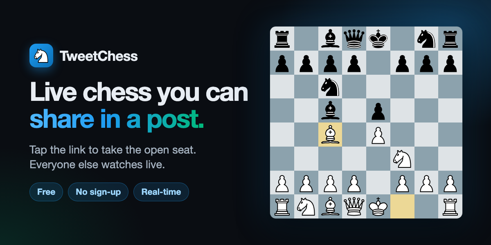

# Timeline Games ♟️🃏

Free, real-time **chess** and **Texas Hold'em** in the browser, made to be shared in a post on X.
Find an opponent, send a friend a link, or watch public games live. No accounts, no downloads, no
bill: it runs entirely on Cloudflare's free tier.



**Chess**
- **Find a match**: get paired with the next person looking for a game. Matchmade games are public, with a 3-minute move limit.
- **Play with a friend**: one invite link. Private by default; you can choose to list it on the Live page.
- The permanent public **World Board** (`/world`) and offline **pass-and-play** (`/local`).
- Click, tap or drag to move. Legal-move dots, promotion picker, move list, draw offers, resign, rematch.
- Every rule enforced on the server with chess.js: checkmate, stalemate and every draw rule.

**Poker** (play money only)
- No-limit Texas Hold'em for 2–6 players. Blinds 5/10, 1,000 free chips, 30 seconds per action.
- **Find a table** seats you at a public table with an open seat, opening a new one if needed.
- **Private table**: invite friends with a link. Private tables never appear in public lists.
- Side pots, split pots, all-ins, automatic check/fold on timeout, sitting out, free top-ups.
- The deck and every hole card stay on the server. Nobody, including spectators, receives cards they shouldn't see.

**Everywhere**
- **Watch live** (`/live`): public chess games and poker tables, with Chess/Poker tabs and filters (playing now, waiting for players, open seats).
- Pick any display name. "Continue your game" on the homepage takes you back to your seat.
- X link previews with a chess or poker image, plus a **Post on X** button (no X API needed).
- Dark, mobile-first UI that works down to 320 px wide (X's in-app browser included). Keyboard and screen-reader friendly.

### Play money only

Poker chips are free and have no value. There is no real money, no crypto, no purchases, no prizes and
no cash-out, and chips can't be transferred between players. If you run out, you can take another free
1,000 chips.

## What it costs: $0

| Need | What we use | Price |
| --- | --- | --- |
| Hosting + domain | Cloudflare Workers + free `*.workers.dev` URL | Free plan |
| Multiplayer servers + database | Durable Objects with SQLite storage | Free plan |
| Chess rules | [chess.js](https://github.com/jhlywa/chess.js) | Open source |
| Chessboard | [react-chessboard](https://github.com/Clariity/react-chessboard) | Open source |
| Poker rules, shuffling, hand ranking | Written for this project (`worker/poker/`) | — |
| X integration | Link-preview meta tags + Web Intent link | No X API needed |

No credit card is needed. See [Free-tier limits](#free-tier-limits-and-capacity) for what happens at
high traffic.

## Quick start (on your computer)

You need [Node.js](https://nodejs.org) 20 or newer (`node -v` to check).

```bash
cd tweetchess
npm install        # download the libraries (takes a minute)
npm run dev        # start the local server
```

Open <http://localhost:5173>. To try multiplayer on one computer, use a **private window** or a second
browser as the other player (each window is a separate guest):

- **Chess:** *Play with a friend → Create invite link*, then open the link in the private window.
- **Poker:** *Poker → Create private table*, then open the table link in one or more private windows and
  press **Take a seat**. A hand starts when two players are seated.
- **Matchmaking / Find a table:** click it in two different windows.

`npm run dev` runs the real Worker and Durable Object code locally (via Cloudflare's Vite plugin), so
multiplayer works offline. Press `Ctrl+C` to stop it.

## Deploy to your free workers.dev URL

1. **Create a free Cloudflare account** at <https://dash.cloudflare.com/sign-up>. No card is required.
2. **Log in from the terminal.** This opens your browser; click *Allow*:
   ```bash
   npx wrangler login
   ```
3. **Deploy.** This builds the app and uploads it:
   ```bash
   npm run deploy
   ```
   On your first deploy, Wrangler may ask you to pick a free `workers.dev` subdomain (for example
   `yourname`). You can also set it in the dashboard under *Workers & Pages*.
4. Wrangler prints your URL, e.g. `https://tweetchess.yourname.workers.dev` (the Worker keeps its
   original name, `tweetchess`). Open it and check `/health`, then follow the
   [manual test checklist](docs/TESTING.md#manual-checklist-after-npm-run-deploy).
5. Share a game or table link on X: paste it into the post composer and a preview card appears. See
   [docs/X-INTEGRATION.md](docs/X-INTEGRATION.md).

To update the site later, run `npm run deploy` again. Game and table links keep working because their
state lives in Durable Objects, not in the deployed code. Connected players reconnect automatically.

## Commands

| Command | What it does |
| --- | --- |
| `npm run dev` | Local development server with hot reload (<http://localhost:5173>) |
| `npm run build` | Type-check and build the app and Worker into `dist/` |
| `npm run preview` | Build, then run the production build locally (<http://localhost:4173>) |
| `npm run deploy` | Build and deploy to Cloudflare |
| `npm test` | Unit tests + Worker/Durable Object integration tests |
| `npm run test:e2e` | Browser tests (run `npx playwright install chromium` once first) |
| `npm run typecheck` | TypeScript checks for app, Worker and tests |
| `npm run lint` | Lint with oxlint |
| `npm run generate:assets` | Re-create the link-preview images in `public/` and `public/favicon.svg` |
| `npm run cf-typegen` | Regenerate `worker-configuration.d.ts` after editing `wrangler.jsonc` |

## Project structure

```
tweetchess/
├── wrangler.jsonc          Cloudflare config: Worker, static assets, 3 Durable Object classes (SQLite)
├── vite.config.ts          Vite + React + Cloudflare plugin
├── index.html              App shell incl. Open Graph / X card meta tags
├── public/                 og-image.png, og-chess.png, og-poker.png (1200×600 previews), favicon.svg, robots.txt
├── shared/                 Code used by both browser and server
│   ├── protocol.ts         Chess messages + strict validation
│   ├── poker.ts            Poker messages + strict validation, public/private view types
│   ├── lobby.ts            Matchmaking messages, Live directory types
│   └── names.ts            Display-name rules
├── worker/
│   ├── index.ts            Worker entry: page routes, /health, /api/* (rooms, matchmaking, poker, live)
│   ├── chess-room.ts       ChessRoom Durable Object: one per chess game
│   ├── match.ts            Pure chess-match rules (seats, moves, endings, rematch)
│   ├── policies.ts         Rules per chess room kind: private, world, match
│   ├── poker-table.ts      PokerTable Durable Object: one per poker table
│   ├── poker/              Pure poker engine: cards + secure shuffle, hand evaluator, betting rules
│   ├── lobby.ts            GameLobby Durable Object: matchmaking, table finder, Live directory
│   ├── crypto.ts           Token hashing, room IDs, unbiased random numbers
│   └── pages.ts            Injects link-preview tags into index.html (HTMLRewriter)
├── src/                    React app
│   ├── App.tsx             Routes: /, /chess, /chess/matchmaking, /game/:id, /world, /local,
│   │                       /poker, /poker/table/:id, /live, /chess/live, /poker/live
│   ├── pages/              One component per page
│   ├── components/         Board, poker table and betting bar, playing cards, live-game cards, …
│   ├── lib/                WebSocket hooks (reconnect, heartbeat), guest identity, names, share, API calls
│   └── styles.css          Dark theme
├── test/unit/              Node unit tests (Vitest)
├── test/worker/            Integration tests inside the Workers runtime (@cloudflare/vitest-plugin)
├── e2e/                    Playwright browser tests
├── scripts/                generate-assets.mjs (preview images + favicon)
└── docs/                   TESTING.md, X-INTEGRATION.md
```

## How it works

```
Browser ──HTTPS──▶ Worker ──▶ static files (free, unlimited)
   │                 │
   └──WebSocket──────┼──▶ ChessRoom    one per chess game     SQLite: room row + moves
                     ├──▶ PokerTable   one per poker table    SQLite: one row with the whole table
                     └──▶ GameLobby    one for chess, one for poker
                                       SQLite: matchmaking pairings + Live directory listings
```

Each game and table is its own [Durable Object](https://developers.cloudflare.com/durable-objects/): a
small server with its own SQLite database that every player of that game connects to. It holds the
official state, so two browsers can never disagree.

### Guests, names and seats

- Each browser makes a random 256-bit token and keeps it in `localStorage`. It is sent only inside the
  WebSocket, never in a URL or log, and servers store only its SHA-256 hash.
- Display names are 2–20 letters, numbers, spaces and `. _ ' -`, checked on the server. Names are the
  only thing other people see; the Live page never shows names.
- Seats are assigned in one synchronous step inside the game's object, so two people can never get the
  same seat. Refreshing or reconnecting puts you back in your seat.

### Chess

- A move message looks like `{"type":"move","from":"e2","to":"e4","expectedPly":0}`. The server checks
  the player's seat, that the game is active, the sequence number (`expectedPly`, which rejects outdated
  or duplicated moves), whose turn it is, and legality with chess.js. Only then does it write to SQLite
  and broadcast the new state. Rejected moves change nothing.
- Room kinds (`worker/policies.ts`):

  | | Friend game | Matchmade game | World Board |
  | --- | --- | --- | --- |
  | Who sits | First two visitors | The two paired players only | Whoever grabs a free seat |
  | Move limit | None | 3 minutes | 3 minutes |
  | Disconnected player | Seat kept | Loses after 90 s (a no-show before the first move cancels the game) | Loses after 60 s |
  | After the game | Rematch | Rematch or find a new match | Seats open after 30 s |
  | Listed on Live | Only if the creator chooses | Always | Always |
  | Deleted after | 30 days idle | 1 day idle | Never |

- **Matchmaking.** Players waiting for a game hold a WebSocket to the chess lobby. The two who have
  waited longest are paired and get random colours. The pairing is recorded before the room is
  created, so a refresh or a second tab returns the same game instead of making a new one.

### Poker

- **Dealing.** Each hand shuffles a fresh 52-card deck with a Fisher–Yates shuffle driven by the
  runtime's cryptographic random generator (with rejection sampling, so every order is equally likely).
- **Hidden cards.** The deck and all hole cards exist only inside the table's Durable Object. Every
  socket gets its own message: the public table (stacks, bets, board, pot) plus, for a seated player,
  only their own two cards. Spectators get the public table only. Cards are revealed only at showdown,
  and only for players who reached it. Nothing with cards is ever logged.
- **Actions.** `{"type":"act","action":"raise","amount":60,"hand":12,"seq":7}`. The server checks
  seat, turn, hand number and sequence number (stale or duplicate clicks are rejected), and the amount.
  It also handles minimum raises, all-ins that don't reopen betting, returning uncalled bets, side pots
  and odd chips.
- **Timers.** 30 seconds per action, then the player checks if possible or folds. After two missed
  turns in a row they sit out until they press *I'm back*. A hand starts 3 seconds after two players are
  ready, and there are 5 seconds between hands.
- **Leaving.** *Leave table* folds you first if you're in a hand. If you just close the tab, your seat
  is held for 3 minutes at a public table (30 minutes at a private one), then freed.
- **Finding a table.** The poker lobby offers the fullest public table that still has a free seat,
  counting players who are on their way. A table that is waiting for players comes first. If none has
  room, it opens a new table.
- Empty public tables are deleted after 30 minutes, private tables after 24 hours.

### Live directory

- Public games and tables report a small summary to their lobby: status, open seats, the chess
  position or the poker board, and the spectator count. The Live page reads a page of 24 at a time.
- Seats and status are updated immediately, so *Join* buttons stay accurate. The rest is updated at most
  once a minute to save free-tier quota. Open Live pages check for changes every 30 seconds, and only
  while visible.
- Entries that stop updating are hidden after 30 minutes and then deleted. At most 1,000 per game.

### Consistency, crashes, retries and expiry

- **Write, then tell.** Each change is applied in memory, written to the object's SQLite, then
  broadcast. Cloudflare holds outgoing messages until the write is durable, so nobody sees a move or
  card that was not saved.
- **Restarts.** If an object restarts (a deploy, a crash, or eviction), it reloads from SQLite on the
  next message. Browsers reconnect with exponential backoff (0.5 s up to 30 s, with jitter), right away
  when the network or tab comes back, and always receive the full state again.
- **Hibernation.** Idle objects sleep while their WebSockets stay open. Heartbeat pings are answered
  without waking them.
- **Timers.** Each object keeps one alarm set for its earliest deadline (move limit, poker action timer,
  next hand, seat release, expiry).
- **Matchmaking failures.** If a matched game can't be created, both players go back to the front of
  the queue and pairing is retried shortly.
- **Directory.** The directory is best-effort. If an update is lost, the next change refreshes it.
  Entries that stop updating expire, so the Live page can't fill up with dead games.

### Protection

- Strict message validation, a 1 KB message size limit, and a per-connection rate limit (bursts of 20,
  then 5 messages a second; 10 and 2 in the lobby).
- Same-origin checks for WebSockets and for creating games and tables.
- At most 500 spectators per chess game and 200 per poker table. Seated players always get back in, and
  sockets that never identify themselves are closed when a room is busy.
- Best-effort per-IP limit: 30 new games, tables or table searches per minute.
- Content-Security-Policy; the site can't be framed by other sites.

## Configuration

Nothing is required; there are no secrets or environment variables to set.

- `wrangler.jsonc`:
  - `run_worker_first` sends only page routes and `/api/*` to the Worker; everything else is served as free static files.
  - `exports` declares the `ChessRoom`, `PokerTable` and `GameLobby` Durable Objects with `"storage": "sqlite"`, the backend the free plan supports.
  - `vars.ALLOWED_ORIGINS` (optional, comma separated) allows other sites to open WebSockets, for example a custom domain in front of the Worker.
- Tunables:
  - `worker/policies.ts`: chess room kinds (seat grace, move limits, expiry)
  - `worker/chess-room.ts`: `LIMITS` (500 spectators, 1,000 sockets), `DIRECTORY` (Live refresh)
  - `worker/poker/engine.ts`: `DEFAULT_CONFIG` (blinds, starting stack, seats, action time)
  - `worker/poker-table.ts`: `POKER_TIMING` (start delay, seat grace, expiry, Live refresh), `POKER_LIMITS`
  - `worker/lobby.ts`: matchmaking limits, reservation time, Live directory size
  - `worker/index.ts`: per-IP creation limit, `/api/live` cache

## Free-tier limits and capacity

Workers Free plan (daily limits reset at 00:00 UTC):

| Resource | Free allowance | What uses it |
| --- | --- | --- |
| Worker requests | 100,000 / day | 1 per page load, API call or WebSocket connect. **Static files don't count** |
| Worker CPU | 10 ms / request | Validating a chess move takes ~0.15 ms |
| Durable Object requests | 100,000 / day | 1 per WebSocket connect, per message a player sends, per lobby update and per alarm |
| Durable Object duration | 13,000 GB-s / day | Only while code is running; idle objects with hibernating WebSockets aren't billed |
| SQLite rows written | 100,000 / day | Moves, poker actions, lobby updates |
| SQLite storage | 5 GB total | A few KB per game; old games and tables are deleted |

Rough costs. The poker numbers were measured on the local Workers runtime. Each WebSocket message is
counted as a full request here: Cloudflare describes a 20:1 discount for incoming WebSocket messages for
paid billing, so these estimates err high.

| Activity | Durable Object requests | Rows written |
| --- | --- | --- |
| Chess game, 40 moves each | ~100 | ~170 |
| Poker hand, 6 players, everyone calls to showdown (24 actions) | ~27 | 25 |
| Poker hand where everyone folds to the big blind | ~7 | 6 |
| Public game or table on the Live page | +1 per minute while active | +2 per minute while active |
| Spectator joining | 2 (plus 1 Worker request) | 0 |
| Matchmaking search | ~4 | ~2 |

If everything went to one activity, a day's free allowance is roughly **550 chess games** or **3,500–7,000
poker hands**. Real traffic mixes both and adds page loads. This is sized for friends and small
communities, hundreds of games a day; it is not built for huge simultaneous crowds.

**If a limit is hit**:
- On the Free plan, requests fail until the daily reset. You are **not** charged or auto-upgraded; paid usage requires subscribing to the Workers Paid plan yourself.
- The site shows "temporarily unavailable" and retries slowly.
- When the Worker request quota runs out, Cloudflare shows error 1027.

**Monitoring your usage** (Cloudflare dashboard):
- *Workers & Pages → tweetchess → Metrics* for requests and errors.
- *Workers & Pages → Durable Objects* for Durable Object usage. Pick the `ChessRoom`, `PokerTable` or `GameLobby` namespace for its metrics.
- `npx wrangler tail` shows live error logs from the deployed Worker (free).
- *Manage account → Billing* to confirm you are still on the Free plan.

## Troubleshooting

| Problem | Fix |
| --- | --- |
| `You are not authenticated` on deploy | Run `npx wrangler login` (or `npx wrangler logout` then login to switch accounts) |
| Deploy asks for a workers.dev subdomain | Pick any free name. It becomes `https://tweetchess.<name>.workers.dev` |
| Deploy error mentioning `migrations` and `exports` | Keep only the `exports` block in `wrangler.jsonc`. A Worker can use one format, not both |
| Deploy error `free_tier_requires_sqlite` | Keep `"storage": "sqlite"` for every Durable Object class |
| Error 1027 / "temporarily unavailable" | A free daily limit was reached. It resets at 00:00 UTC |
| Stuck on "Reconnecting…" | Open `/health`. If it works, check for VPNs/extensions blocking WebSockets. If you use another domain, add it to `ALLOWED_ORIGINS` |
| "Please reload" message | The site was updated (protocol changed); reload the page |
| *Find a match* keeps searching | It needs a second person searching at the same time. To test alone, search from a private window too |
| A poker hand doesn't start | Two seated players must be online and not sitting out |
| "You are creating games very quickly" | The per-IP limit (30 a minute) was reached; wait a minute |
| A game isn't on the Live page | Friend games and private tables are never listed unless the creator chose it (chess only). Listings refresh about once a minute |
| No preview card on X | View the page source: the `twitter:*` tags must have absolute `https://` URLs. Check `/robots.txt`. X caches cards ~7 days, so test with a new link |
| Port 5173 already in use | `npm run dev -- --port 5174` |
| Reset local test data | Stop the dev server and delete the `.wrangler/state` folder |
| `npm install` warns about "install scripts" | Harmless with npm 11+. Cloudflare's runtime ships as a platform package |
| Playwright says a browser is missing | `npx playwright install chromium` |
| Types out of date after editing `wrangler.jsonc` | `npm run cf-typegen` |

## Testing

Automated tests cover the rules, the servers, persistence and hibernation, hidden poker cards, and real
browser play: 127 unit tests, 73 Worker/Durable Object integration tests and 21 browser end-to-end
tests. Run `npm test` and `npm run test:e2e`. [docs/TESTING.md](docs/TESTING.md) maps each requirement
to its tests and has the manual checklist for the deployed site.

## Credits

- [chess.js](https://github.com/jhlywa/chess.js) (BSD-2-Clause) for chess rules on server and client.
- [react-chessboard](https://github.com/Clariity/react-chessboard) (MIT) for the board. Its piece
  artwork is the classic set by Colin M.L. Burnett (originally on Wikimedia Commons under free licences).
- Built on [Cloudflare Workers](https://developers.cloudflare.com/workers/) and
  [Durable Objects](https://developers.cloudflare.com/durable-objects/).
